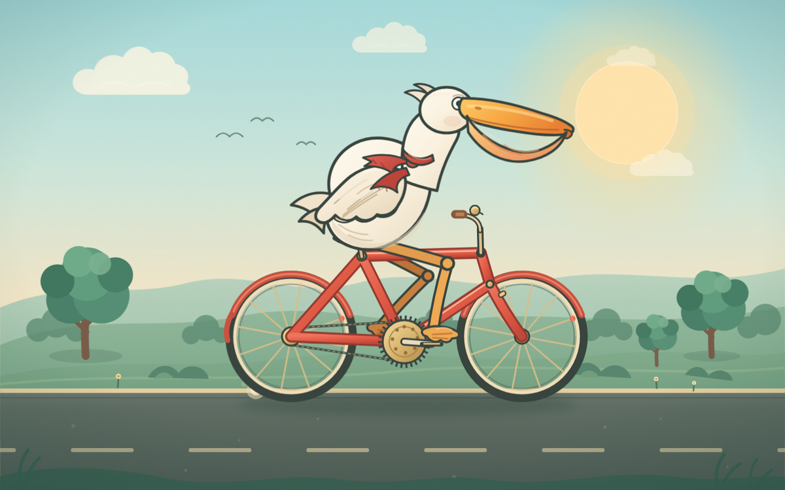

# 骑单车的鹈鹕 · Pelican on a Bicycle

一只戴红围巾的鹈鹕，骑着珊瑚色自行车穿过暖光里的乡间公路。  
纯 SVG + CSS + 少量原生 JavaScript，单文件 HTML，打开即播。

**在线观看：<https://3-dd-del.github.io/pelican-bicycle/>**

<p>
  
  
  
  <a href="https://3-dd-del.github.io/pelican-bicycle/"></a>
</p>

[](https://3-dd-del.github.io/pelican-bicycle/)

## 这是什么

一幅可以播放的侧视插画：白色鹈鹕坐在一辆珊瑚色城市自行车上，沿着乡间公路向前骑。

它不依赖图片素材、字体文件、动画库或构建工具。所有角色、车辆、背景和动效都写在一个 `index.html` 里，双击即可离线播放。

## 动画里有什么

- **车轮与传动**：辐条随车轮旋转，链条持续流动，曲柄和踏板按同一角度转动
- **踩踏联动**：两条腿用二段式 IK 求解膝盖位置，脚掌始终落在踏板上；左右脚相位相反
- **鹈鹕的动作**：身体随踏频轻轻起伏，头与喙同相位点动，翅膀缓慢摆动，红围巾在风里抖动，还会偶尔眨眼
- **道路与风**：路面虚线向后滚动，路边草丛摇摆，车后扬起尘土和速度线
- **环境细节**：太阳光晕、云朵、远山、树影、野花、车铃、反光片和轮胎触地阴影

整个画面会一直循环，没有加载动画，也没有播放按钮。

## 技术实现

| 部分 | 做法 |
| --- | --- |
| 画面 | 内联 SVG，`viewBox="0 0 1200 760"`，随窗口铺满 |
| 角色与车辆 | 纯矢量路径绘制，未使用位图 |
| 环境动效 | CSS `@keyframes`：云、路面、草丛、尘土、速度线 |
| 车轮/链条/围巾/眨眼 | SMIL：`<animate>` 与 `<animateTransform>` |
| 双腿与曲柄 | `requestAnimationFrame` + 三角函数定位踏板，再用二段式 IK 解膝盖 |
| 响应式 | `preserveAspectRatio="xMidYMid slice"` 铺满窗口；竖屏会裁切两侧，桌面全屏效果最佳 |
| 可访问性 | SVG `role="img"`、`<title>` / `<desc>`；`prefers-reduced-motion` 下同时暂停 CSS、SMIL 和 JS，保留一帧静态画面 |
| 依赖 | 0，直接双击 `index.html` 即可运行 |

没有 Canvas、WebGL、第三方库或网络请求。

## 本地运行

直接打开：

```text
双击 index.html
```

或者用任意静态服务器：

```bash
python -m http.server 8080
# 打开 http://localhost:8080
```

不需要 `npm install`、不需要构建，也不需要后端。

## 文件结构

```text
.
├── index.html    # 完整动画：SVG + CSS + SMIL + JavaScript
├── preview.png   # README 预览图
├── .nojekyll     # GitHub Pages 跳过 Jekyll
└── README.md
```

## 浏览器支持

面向现代桌面浏览器：Chrome、Edge、Firefox、Safari。  
使用原生 SVG / SMIL / CSS 动画，不经过编译，也不需要 polyfill。

## 设计笔记

选鹈鹕，是因为它的侧面轮廓足够夸张：长喙、大喉囊、短腿、圆身体，和一辆细管的复古自行车放在一起，天然有喜剧感。

配色从天空的青绿过渡到地平线的奶油和蜜桃色，自行车用珊瑚红作为视觉中心，鹈鹕保持暖白，只让红围巾做一点跳跃。画面里没有文字，让动作和颜色自己说话。

## 关于

这是一个关于「用尽量少的文件，把一个动作做得可信」的视觉练习：轮子要转，踏板要跟脚，围巾要像被风吹到，而不是随机抖动。

由 [@3-dd-del](https://github.com/3-dd-del) 制作。  
在线观看：<https://3-dd-del.github.io/pelican-bicycle/>

## 许可

代码与插画由作者制作。仓库暂未附带开源许可证；如需转载、商用或二次发布，请先联系作者。
